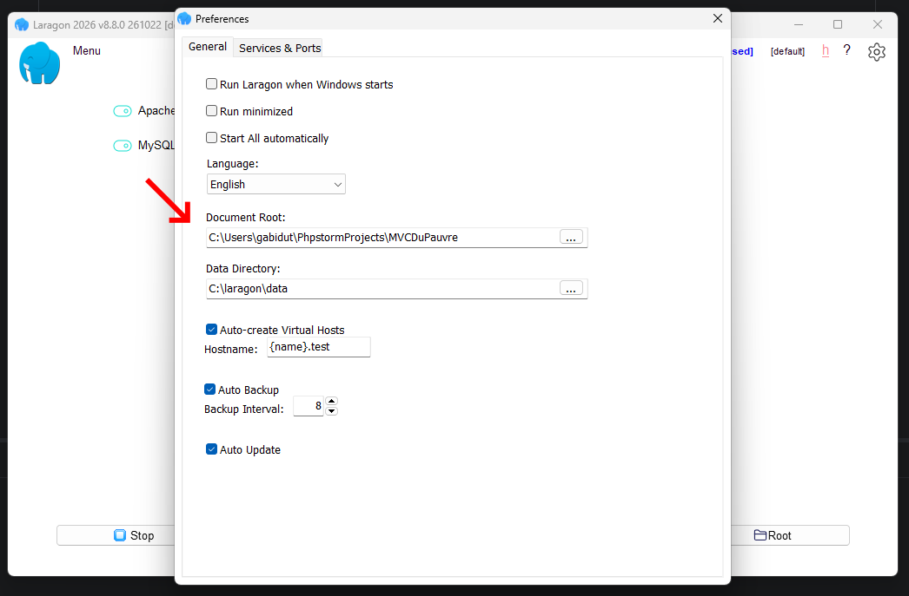
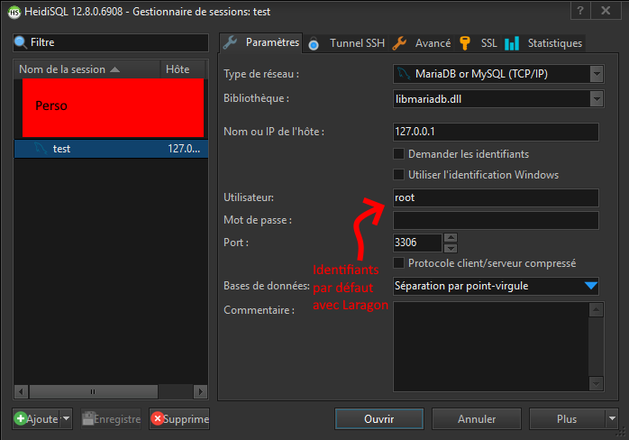
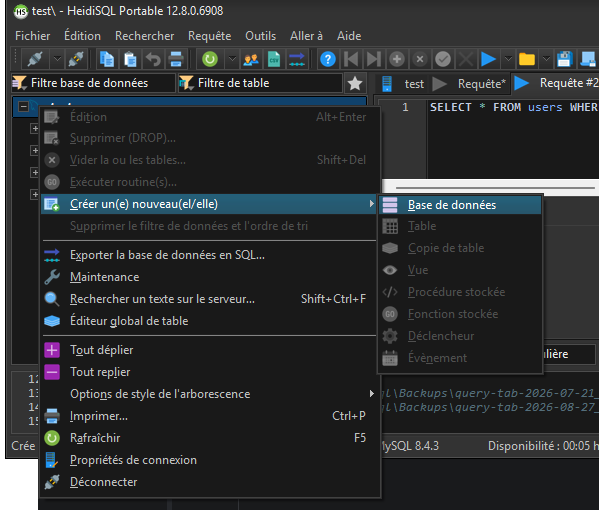
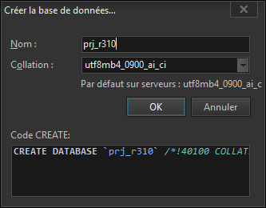
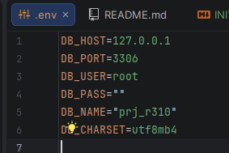

# Initialisation du projet et création de la BDD
Afin de préparer le projet sur votre machine, il vous faudra d'abord : 

- Un serveur web (Xampp, Laragon, info.users unicaen, ...)
- Un interpréteur PHP (>8.4+)
- Un explorateur MySQL (phpMyAdmin, MySQL Workbench, HeidiSQL, ...)

## 1. Préparation de l'environnement

Je part du principe que vous avez déjà cloné le projet sur votre machine. 

Dans ce cas, il vous faut donc mettre le dossier d'execution de votre serveur web sur la racine du projet.
Exemple avec Laragon : 

### La commande magique

Si vous voulez simplement lancer le projet, vous pouvez utiliser la commande suivante dans votre terminal (**à la racine du projet**) :

```bash
php -S localhost:8000 dev-router.php
```

*Note : dans ce cas d'usage, aucune BDD ne sera créée, vous ne pourrez donc pas vous connecter à l'API.*

## 2. Création de la base de données

Une fois cela fait, il vous faudra créer la base de données. Pour cela, vous pouvez utiliser un explorateur MySQL (phpMyAdmin, MySQL Workbench, HeidiSQL, ...).
Nommez là à votre convenance, notez simplement le nom que vous lui donnez, car il vous faudra le renseigner dans le fichier .env.


Exemple avec HeidiSQL :



> **__⚠️⚠️⚠️ VOUS N'AVEZ PAS BESOIN DE CREER LES TABLES, LE SCRIPT PHP S'EN CHARGERA !!!__**

## 3. Configuration du fichier .env

Le fichier .env est un fichier de configuration qui contient les informations nécessaires à la connexion à la base de données. Il se trouve dans le dossier back/.env.

Par défaut, il n'est pas copié, il est simplement nommé .env.example. Il vous faudra donc le copier et le nommer en .env et le modifier pour y mettre vos informations de connexion à la base de données.

Par exemple, avec les captures d'écran précédentes, le fichier .env devrait ressembler à ceci :



Dès votre premier accès au projet via votre navigateur, le script PHP se chargera de créer les tables nécessaires à l'application dans la base de données que vous avez créée.
> **__⚠️⚠️⚠️ NE JAMAIS PUSH VOTRE FICHIER .env !!!__**