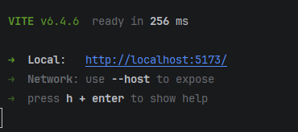

# Projet R3.10

## Fonctionnement du Front-End

Le front-end fonctionne via le procédé du [Single Page Application (SPA)](https://developer.mozilla.org/fr/docs/Glossary/SPA). Cela signifie que l'application est chargée une seule fois et que les différentes vues sont gérées par le JavaScript côté client, sans rechargement complet de la page.
<br>Afin de tester, vous devez donc avoir un serveur web local capable de modifier les requêtes du clients pour qu'elles soient redirigées vers le fichier index.html. Pour cela vous avez un fichier .htaccess ou un la possibilité d'utiliser ViteJS.

## Apache/Nginx via .htaccess
Pour Apache, vous pouvez utiliser le fichier `.htaccess` fourni dans le projet. Il redirige toutes les requêtes vers `index.html`, sauf si le fichier ou le répertoire existe. Pour Nginx, vous pouvez configurer le serveur pour qu'il redirige toutes les requêtes vers `index.html` de manière similaire.
Définissez le répertoire racine de votre serveur web sur le dossier `front` du projet.

## ViteJS
Le seul prérequis pour utiliser ViteJS est d'avoir Node.js installé sur votre machine. Vous pouvez vérifier si Node.js est installé en exécutant la commande suivante dans votre terminal :

```bash
node -v
```

Si c'est le cas, executez simplement la commande suivante dans le répertoire `front` du projet pour démarrer le serveur de développement ViteJS :

```bash
npm run dev
```

Si le serveur démarre correctement, vous devriez voir un message indiquant que le serveur est en cours d'exécution et l'URL à laquelle vous pouvez accéder à l'application. Par défaut, ViteJS utilise le port 5173 (par défaut), donc vous pouvez accéder à l'application en ouvrant votre navigateur et en visitant l'URL indiquée dans la console.


## Fonctionnement technique du router

Comme dans le back en PHP, le routeur utilise la propriété du lien `pathname` de `window.location` ([Documentation MDN ici](https://developer.mozilla.org/fr/docs/Web/API/Window/location))
L'objet `window.location` contient des informations sur l'URL actuelle de la page. La propriété `pathname` renvoie le chemin de l'URL, c'est-à-dire la partie de l'URL qui suit le nom de domaine et qui précède les paramètres de requête (query parameters) et le fragment (hash).


Ici, le routeur s'intéresse à la partie "path to the file", qu'il va lire et comparer avec les routes définies dans les modules. Si une correspondance est trouvée, le routeur va charger le module correspondant et afficher la vue associée.

> Dans le routeur, afin d'éviter tout souci de chemin relatif, les chemins des vues sont définis avec un indicateur spécial `Route.LOCAL_MODULE_PATH_INDICATOR`. Lors de la résolution de la vue, le routeur remplace cet indicateur par le chemin réel du module, garantissant ainsi que les ressources sont correctement localisées.
> `Route.LOCAL_MODULE_PATH_INDICATOR` est disponible dans /front/js/router/route.js et est défini comme une constante statique de la classe Route.